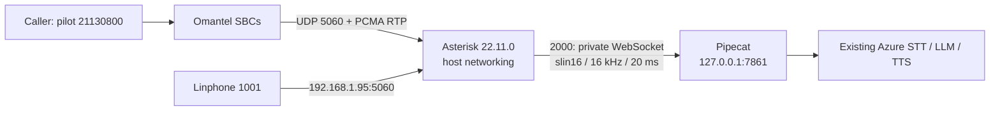

# Voice server and Asterisk recovery

**Web dialer update:** the browser microphone client has been replaced by the
[telephone call desk](WEB_DIALER.md). Once installed, recovery must also restore
`config/manager.conf`, PBX `compose.web.yml`, and the application's private
`DIALER_PASSWORD`/`ASTERISK_AMI_SECRET`. Include `-f compose.web.yml` in PBX
recreation commands below, after `-f compose.yml` and before any image override.
The web dialer guide supplies deployment, recovery options and rollback. AMI adds
a sixth config mount. The old `omantel-outbound-test` remains disabled while the
new authenticated web route can originate calls when explicitly enabled.

Recovery record: 2026-11-04, Asia/Dubai. This guide covers the Omantel pilot,
Asterisk, its Pipecat media bridge, and the application files needed to restore
them. Use the **private live backup** first. The repository also provides a
complete reconstruction recipe if the PBX files are lost.

The user reports that Linphone, pilot Echo, the pilot AI call, and the subsequent
secondary monitoring procedure all work. The exact primary contact output was
`Avail`, RTT `48.503 ms`; the later secondary success was reported without raw
output. Automatic failover and real outbound calling have **not** been tested or
enabled. Full Omantel DID-block/channel activation has not been confirmed.

No server backup or disaster-restore drill has been run from this Windows
workspace. The commands below must be executed on Ubuntu by the operator.

## Contents

1. [System map and fixed settings](#system-map-and-fixed-settings)
2. [Take a private backup now](#take-a-private-backup-now)
3. [Container lost or stopped](#container-lost-or-stopped)
4. [Restore from the private backup](#restore-from-the-private-backup)
5. [Reconstruct Asterisk without a PBX backup](#reconstruct-asterisk-without-a-pbx-backup)
6. [Restore the host network and firewall](#restore-the-host-network-and-firewall)
7. [Start and verify](#start-and-verify)
8. [Rollback and troubleshooting](#rollback-and-troubleshooting)
9. [Recovery drill and remaining limits](#recovery-drill-and-remaining-limits)

## System map and fixed settings



| Item | Working configuration / recovery requirement |
|---|---|
| PBX host directory | `/home/data_mining/voice-pbx` |
| Compose / container | `compose.yml`, project `voice-pbx`, service `asterisk`, container `voice-pbx-asterisk-1` |
| Asterisk version | `22.11.0`, including `chan_websocket`, JSON media control, PJSIP ACL/IP identification, A-law and resampling |
| Network mode | Linux Docker **host** for PBX and agent; no SIP/RTP port publishing |
| Internet Ethernet | `enp10s0`, current DHCP IP `192.168.1.95`, gateway `192.168.1.1`, route metric 100 |
| Wi-Fi fallback | `wlp9s0`, observed `192.168.1.102`, route metric 600; managed by NetworkManager |
| Carrier cable | Dedicated Ethernet `enp11s0` connected to Huawei ONT **LAN3** |
| Carrier IP / gateway | `100.127.29.138/30`, next hop `100.127.29.137` |
| SBCs | Primary `212.72.15.217`, secondary `212.72.15.220`; each has a `/32` route via the carrier gateway/interface |
| SIP transports | `transport-udp` at `192.168.1.95:5060`; `omantel-udp` at `100.127.29.138:5060`; both UDP |
| Omantel registration | **None**; IP authentication, separate endpoint/AOR/identify for each SBC |
| Media | Omantel: only PCMA/G.711 A-law, 8 kHz, 20 ms; in-band DTMF, no negotiated telephone-event |
| Asterisk RTP range | UDP `10000–10100`, strict RTP; actual carrier media addresses must be reachable via `enp11s0` |
| Heartbeats | Each SBC: `qualify_frequency=30`, timeout 3 seconds, successful 2xx qualification |
| Assigned block | `21130800–21130899` (`211308XX`) |
| Active pilot / DOD identity | `21130800`; `send_pai=yes`; only assigned identities may be used |
| Service/account reference | `9999421`; do not substitute this seven-digit reference for the pilot DID/DOD |
| Linphone | Extension/auth username `1001`; **password is private and must be backed up** |
| Existing local routes | `6000@from-linphone`: Echo; `2000@from-linphone`: `Dial(WebSocket/pipecat/c(slin16)f(json),30)` |
| Carrier inbound route | Only `21130800@from-omantel` → `Goto(from-linphone,2000,1)`; other numbers rejected |
| WebSocket bridge | `ws://127.0.0.1:7861/telephony/media`, subprotocol `media`, per-call client `pipecat` |
| Bridge PCM | Mono signed linear 16-bit / 16 kHz, 640 bytes per 20 ms frame; Asterisk transcodes PCMA; existing adapter resamples TTS |
| Health | `http://127.0.0.1:7861/health`; idle response has `status=ok`, `calls=0` |
| Outbound / failover | Disabled; secondary qualification is not tested call failover |

The actual application directory, `.env`, agent selection, questionnaire, Azure
endpoint/keys, voices, private SIP password, image IDs and effective process
environment come from the private backup. `.env.example` is a reference, not a
copy of the live secrets or necessarily the exact active agent configuration.
Baseline services are Azure streaming STT, GPT-4.1-mini and Azure TTS; restore the
actual provider/model/voice choices instead of resetting them to guessed defaults.

Both containers use the same host loopback. Docker bridge mode makes
`127.0.0.1:7861` refer to the wrong namespace and breaks this topology. Host mode
also means the host firewall controls listeners. See [Docker host networking](https://docs.docker.com/engine/network/drivers/host/).

The five PBX files are **individual file mounts**, read-only inside the container:

```text
config/pjsip.conf            -> /etc/asterisk/pjsip.conf
config/extensions.conf       -> /etc/asterisk/extensions.conf
config/rtp.conf              -> /etc/asterisk/rtp.conf
config/websocket_client.conf -> /etc/asterisk/websocket_client.conf
config/logger.conf           -> /etc/asterisk/logger.conf
```

Current working PJSIP and dialplan files have the Omantel sections **inlined**.
Do not replace them with the initial `deploy/omantel/staged/omantel-pjsip.conf`
include wrapper: its extra files are not mounted. Likewise, the original staged
dialplan defaults to Echo/primary-only; it is not the final AI/two-peer setup.

## Take a private backup now

From the application checkout on Ubuntu, after these backup scripts are present:

```bash
sudo python3 -m scripts.backup_voice_server \
  --app-dir "$PWD" \
  --output-dir /root/voice-backups \
  --save-images
```

This does not restart/reload services, modify routes/firewalls or place calls.
Allow enough disk space for the image export and final compressed archive at the
same time. Do not edit deployment files while taking the snapshot.

The backup includes:

- The entire PBX directory: actual Dockerfile/Compose, live configs, and private
  original/Echo/AI/secondary rollback snapshots if present.
- Application source and assets, lockfiles, custom questionnaires and private
  `.env`; excludes `.git`, virtual environments, node_modules and selected caches.
- `/etc/netplan`, any additional `/lib/netplan` and `/run/netplan` source layers,
  `/etc/omantel-signaling.nft`, and the dedicated firewall service unit.
- Private Docker inspection data for the actual PBX and agent, including image
  IDs, Compose project labels, mounts, restart policies and environment values.
- Runtime network/firewall inventory, Asterisk status, container numeric identity,
  source Git commit/dirty status/origin, and whether exact images were saved.
- With `--save-images`, the actual image IDs used by both containers, including
  their layers. This avoids depending on a later rebuild or a changed image tag.
- A SHA-256 checksum next to the archive.

If agent discovery fails, identify its name with `docker ps` and add
`--agent-container ACTUAL_AGENT_CONTAINER`. The script refuses to silently omit
external bind mounts; supply each missing source using `--extra /actual/path`.
Named/anonymous Docker volumes require their own data backup; the current supplied
Compose configuration uses file mounts rather than such volumes.

Also inventory any external questionnaire/call-selection/customer-data paths
referenced by `.env` or symlinks, and include their host source paths with `--extra`.
If the browser/public access path must also survive, include its actual Nginx
configuration, TLS certificates and SSH tunnel/service configuration. For example,
`--extra /etc/nginx --extra /etc/letsencrypt` if those directories belong to this
deployment and exist. Back up the separate public VM/coturn service independently;
it cannot be recovered from the Ubuntu PBX's files alone. Keep SSH access keys and
the exact tunnel unit in secure private storage as well.

The archive and container metadata contain **real SIP/Azure credentials**, Wi-Fi
credentials where present, and possibly customer configuration. Keep them out of
Git/chat and encrypt before copying off the server. For example, replacing the
filename with the archive printed by the script:

```bash
sudo gpg --symmetric --cipher-algo AES256 \
  /root/voice-backups/voice-recovery-TIMESTAMP.tar.gz
```

GPG prompts for the passphrase; do not put it on the command line. Copy the `.gpg`
and `.sha256` files to separate secure storage and keep the passphrase outside
the failed server's disk. A backup left only under `/root` does not survive losing
the server. Confirm the off-server copy can be decrypted and its checksum verified.
The backup script itself creates a private unencrypted archive; encryption and
the off-server copy are operator steps, not claimed completed automatically.

Docker image archives restore layers/images, not the live bind-mounted configs or
private application `.env`. Keep all parts of the backup together. See
[Docker image save](https://docs.docker.com/reference/cli/docker/image/save/) and
[image load](https://docs.docker.com/reference/cli/docker/image/load/).

## Container lost or stopped

If the same host, network, image and files remain, avoid a rebuild. Set the actual
application path; do not use an empty replacement `.env`:

```bash
VOICE_APP_DIR=/home/data_mining/pipecat-example  # replace if different
VOICE_PBX_DIR=/home/data_mining/voice-pbx

sudo systemctl start docker
sudo systemctl start omantel-signaling.service

cd "$VOICE_APP_DIR"
sudo docker compose -f docker-compose.ubuntu.yml up -d --no-build agent
curl --fail --max-time 5 http://127.0.0.1:7861/health

cd "$VOICE_PBX_DIR"
sudo docker compose -p voice-pbx -f compose.yml up -d --no-build asterisk
sudo docker exec voice-pbx-asterisk-1 asterisk -rx 'core show version'
```

For an existing stopped PBX container, `sudo docker start voice-pbx-asterisk-1`
also works once its addresses and mounted files exist. If an image is missing,
load the saved image or use the rebuild procedure below.

The repository's Ubuntu **agent** Compose has `restart: "no"`. Consequently,
starting Docker or rebooting the host does not guarantee the agent starts again.
Start it explicitly as above. The PBX uses `restart: unless-stopped`, but that
does not undo a deliberate manual stop. To adopt automatic agent restart later,
use a reviewed Compose override with `restart: unless-stopped`; it requires
recreating the agent and is not applied by this documentation task.

## Restore from the private backup

### Extract into a review directory

On a fresh/replacement Ubuntu host, use the same architecture as the saved images
(the original is x86_64). Install Docker Engine/Compose and ensure Python 3.10+,
`ip`, `networkctl`, `netplan`, `nft`, `curl` and `tcpdump` are available. Use the
[official Docker Ubuntu installation instructions](https://docs.docker.com/engine/install/ubuntu/).

Decrypt, verify and extract into a new private directory, **not directly over `/`**:

```bash
gpg --output voice-recovery-TIMESTAMP.tar.gz \
  --decrypt voice-recovery-TIMESTAMP.tar.gz.gpg
sha256sum --check voice-recovery-TIMESTAMP.tar.gz.sha256

sudo install -d -m 700 /root/voice-restore
sudo tar --numeric-owner -xzf voice-recovery-TIMESTAMP.tar.gz -C /root/voice-restore
```

The archive layout is:

```text
metadata/backup.json              original app/PBX paths and snapshot manifest
metadata/containers/asterisk.json  actual PBX image ID, mounts, environment, labels
metadata/containers/agent.json    actual agent image ID, mounts, environment, labels
metadata/checks.json              network, Git, Asterisk and numeric UID/GID inventory
rootfs/home/...                   backed-up PBX/application directories
rootfs/etc/netplan/...            persistent host network configuration
rootfs/etc/omantel-signaling.nft
rootfs/etc/systemd/system/omantel-signaling.service
images/docker-images.tar         present only with --save-images
```

Read `metadata/backup.json` locally for the original paths. Do not share the raw
container inspection files; they can contain credentials. Restore external
`--extra` sources and symlink targets identified by that manifest as well.

### Restore application and PBX directories

For a fresh host, set the paths from the manifest and copy the backed-up source.
The following are the original PBX path and an **example** application path:

```bash
VOICE_APP_DIR=/home/data_mining/pipecat-example  # use metadata/backup.json
VOICE_PBX_DIR=/home/data_mining/voice-pbx
VOICE_RESTORE=/root/voice-restore

sudo test -d "$VOICE_RESTORE/rootfs$VOICE_APP_DIR"
sudo test -d "$VOICE_RESTORE/rootfs$VOICE_PBX_DIR"
sudo install -d -m 750 "$VOICE_APP_DIR" "$VOICE_PBX_DIR"
sudo cp -a "$VOICE_RESTORE/rootfs$VOICE_APP_DIR/." "$VOICE_APP_DIR/"
sudo cp -a "$VOICE_RESTORE/rootfs$VOICE_PBX_DIR/." "$VOICE_PBX_DIR/"
```

These copy commands are for an empty/replacement deployment. On an existing live
host, first preserve the current files and use the settings-only procedure under
rollback. Do not overwrite another working application or its credentials.

### Load exact saved images

If the backup contains images:

```bash
sudo docker image load --input /root/voice-restore/images/docker-images.tar

sudo python3 <<'PY'
import json
from pathlib import Path
import subprocess
root = Path('/root/voice-restore')
for role, tag in (('asterisk', 'voice-pbx-asterisk:recovered'),
                  ('agent', 'voice-agent:recovered')):
    info = json.loads((root / 'metadata/containers' / (role + '.json')).read_text())
    subprocess.run(['docker', 'image', 'tag', info['Image'], tag], check=True)
(root / 'pbx-image.yml').write_text('services:\n  asterisk:\n    image: voice-pbx-asterisk:recovered\n')
(root / 'agent-image.yml').write_text('services:\n  agent:\n    image: voice-agent:recovered\n')
print('Exact saved images tagged; restore overrides prepared. Nothing started.')
PY
```

The overrides ensure Compose uses the exact saved image even if the old project
tag is missing or points at another image. Preserve any additional live Compose
overrides recorded by the container's `com.docker.compose.project.config_files`
label; the default application file alone does not capture unrecorded custom mounts.

After restoring the host network/firewall and private files, start the agent,
check its health, then start Asterisk:

```bash
cd "$VOICE_APP_DIR"
sudo docker compose -f docker-compose.ubuntu.yml \
  -f /root/voice-restore/agent-image.yml config --quiet
sudo docker compose -f docker-compose.ubuntu.yml \
  -f /root/voice-restore/agent-image.yml up -d --no-build agent
curl --fail --max-time 5 http://127.0.0.1:7861/health

cd "$VOICE_PBX_DIR"
sudo docker compose -p voice-pbx -f compose.yml \
  -f /root/voice-restore/pbx-image.yml config --quiet
sudo docker compose -p voice-pbx -f compose.yml \
  -f /root/voice-restore/pbx-image.yml up -d --no-build asterisk
```

`config --quiet` validates Compose without printing expanded secrets. If images
were not saved, build from the restored actual Dockerfiles/lockfiles. A later build
can pick up changed OS packages/base-image tags; it is not a bit-for-bit copy of
the old image. Prefer the exact saved images for the first recovery.

## Reconstruct Asterisk without a PBX backup

The repository contains a complete reconstruction reference under
`deploy/asterisk/`, plus the existing Omantel templates. It recreates five inline
config files, both peers, the AI route, host networking, pinned Asterisk source
version, and host-network/firewall reference files. Outbound and failover stay off.

From the application checkout on Ubuntu, create a **new** directory:

```bash
python3 -m scripts.prepare_pbx_recovery \
  --output /home/data_mining/voice-pbx \
  --lan-ip 192.168.1.95 \
  --generate-password
```

The command refuses an existing destination and never starts Docker or changes
the host. It stores a new random Linphone password privately in
`config/pjsip.conf`; update extension `1001` on the phone after recovery. To retain
the old password, recover it from private storage and use
`--password-file /private/path/linphone-password.txt` instead. The helper accepts
16–128 letters/digits/underscores/hyphens; restore the exact live config directly
if an existing password uses a different format. Never paste the password into
the command line or commit the generated private directory.

Default recovery settings are `deploy/asterisk/recovery-settings.json`:

```json
{
  "number_block_start": "21130800",
  "number_block_end": "21130899",
  "did": "21130800",
  "caller_id": "21130800",
  "outbound_test_numbers": [],
  "outbound_enabled": false,
  "secondary_enabled": true,
  "failover_enabled": false,
  "inbound_mode": "ai"
}
```

For a replacement host's initial carrier test, make a copy of this JSON with
`inbound_mode="echo"` and optionally `secondary_enabled=false`, and pass it using
`--settings /path/to/recovery-settings.json`. Once ordinary audio passes, use the
exact pilot route `Goto(from-linphone,2000,1)`. Do not rerun the new-directory
generator over existing live files.

The reconstruction recipe uses fixed container UID/GID **10001**, unlike the
original live image's dynamically allocated identity. Apply these file permissions
**only to this generated reference bundle**:

```bash
VOICE_PBX_DIR=/home/data_mining/voice-pbx
sudo chown root:10001 "$VOICE_PBX_DIR/config" "$VOICE_PBX_DIR"/config/*.conf
sudo chmod 750 "$VOICE_PBX_DIR/config"
sudo chmod 640 "$VOICE_PBX_DIR"/config/*.conf

cd "$VOICE_PBX_DIR"
sudo docker compose -p voice-pbx -f compose.yml build asterisk
```

The generated `.dockerignore` excludes private config/host files from the build
context. The image recipe is based on the original source-build guide and pins
22.11.0 with upstream checksum verification; it was not built in this Windows
workspace. Do not choose an arbitrary third-party Asterisk image lacking the
WebSocket JSON/media modules. See the [Asterisk WebSocket documentation](https://docs.asterisk.org/Configuration/Channel-Drivers/WebSocket/).

The **agent application** is restored separately. Recover its actual `.env` from
private backup/vault. At minimum retain the actual Azure Speech key/region,
`AZURE_STT_LANGUAGE`, LLM base URL/key/deployment, TTS provider/voice, active
agent/survey/questionnaire selection, and telephone settings:

```dotenv
TELEPHONY_ENABLED=true
TELEPHONY_PORT=7861
TELEPHONY_MAX_CALLS=2
TELEPHONY_MAX_SECONDS=900
```

If no source backup exists, check out the recorded working Git commit and restore
the external prompts/questionnaires/call-selection files and secrets from secure
storage. The exact active persona cannot be reconstructed from a generic sample
`.env` alone. Build the agent using the Ubuntu host-network file:

```bash
cd /actual/application/checkout
sudo docker compose -f docker-compose.ubuntu.yml build agent
```

Do not start either container until the host addresses, firewall and credentials
below are restored. Keep the WebSocket listener private; never expose 7861 through
Nginx, router forwarding or a public Docker port.

## Restore the host network and firewall

Do this before Asterisk starts. A specific-IP listener cannot bind if its IP is
missing. On replacement hardware, identify the actual interface names with
`ip -br link` and the physical cable connected to ONT LAN3. The new machine must
have Omantel access; an arbitrary public VM cannot use this private carrier link.
Confirm with Omantel if a hardware/MAC change requires reprovisioning.

Keep the LAN IP `192.168.1.95` stable using the existing DHCP reservation or an
approved LAN configuration; both Asterisk's local transport and Linphone use it.
Do not turn the Omantel gateway into the server's default internet gateway.
Retain the installer/current internet connection and verify its default route.
Do not blindly copy old Ethernet/Wi-Fi YAML onto renamed interfaces.

Carrier Netplan file `/etc/netplan/90-omantel.yaml`:

```yaml
network:
  version: 2
  ethernets:
    enp11s0:
      renderer: networkd
      dhcp4: false
      dhcp6: false
      accept-ra: false
      optional: true
      addresses:
        - 100.127.29.138/30
      routes:
        - to: 212.72.15.217/32
          via: 100.127.29.137
        - to: 212.72.15.220/32
          via: 100.127.29.137
```

Use the live backup's file, or the generated `host/90-omantel.yaml.proposed` on a
fresh host. Update only the confirmed carrier interface name if it changed. On a
fresh replacement with console access, validate with `sudo netplan generate`,
then use `sudo netplan try --timeout 120` and confirm only after the default route
and remote connectivity pass. On the original/shared host, prefer the isolated
generation/only-`enp11s0` activation procedure recorded in
[the deployment report](OMANTEL_SIP_TRUNK.md). `netplan try` rollback must be
verified; do not treat its timeout as guaranteed recovery. See
[Netplan try](https://netplan.readthedocs.io/en/1.1.2/netplan-try/).

The dedicated firewall table allows only the two SBCs received on `enp11s0` to
`100.127.29.138:5060/UDP` and drops other signaling to that address. Restore:

```text
/etc/omantel-signaling.nft
/etc/systemd/system/omantel-signaling.service
```

Use the backup or generated `host/omantel-signaling.*.proposed` files. If the
interface changed, adjust the nft `iifname` too. Preserve all existing Docker,
host and router protections; never replay the entire saved nft inventory blindly
over a running Docker host or run `flush ruleset`.

For the generated bundle on a fresh host (review an existing destination first):

```bash
VOICE_PBX_DIR=/home/data_mining/voice-pbx
sudo install -m 600 "$VOICE_PBX_DIR/host/90-omantel.yaml.proposed" /etc/netplan/90-omantel.yaml
sudo install -m 600 "$VOICE_PBX_DIR/host/omantel-signaling.nft.proposed" /etc/omantel-signaling.nft
sudo install -m 644 "$VOICE_PBX_DIR/host/omantel-signaling.service.proposed" \
  /etc/systemd/system/omantel-signaling.service

sudo nft --check --file /etc/omantel-signaling.nft
sudo systemd-analyze verify /etc/systemd/system/omantel-signaling.service
sudo systemctl daemon-reload
sudo systemctl enable --now omantel-signaling.service
```

Do not start this service over an already-loaded `inet omantel_signaling` table;
inspect its current state first. Restore network configuration using the separate
procedure above. The service loads the guard after the general nftables service
(if used) and before Docker at boot. It does not restart Docker. A service stop
removes only this table; `active (exited)` is normal for the oneshot service.

This guard filters Omantel signaling only. It is not a complete server firewall
or RTP allowlist. RTP restrictions must use the real carrier media ranges and
retain the LAN phone path. Keep SIP off public router forwards. Do not substitute
the public browser/TURN VM's address for the carrier media/signaling address.

Verify before startup:

```bash
ip -4 addr show dev enp11s0
ip -4 route get 212.72.15.217 from 100.127.29.138
ip -4 route get 212.72.15.220 from 100.127.29.138
ip -4 route get 1.1.1.1
ping -I 100.127.29.138 -c 4 212.72.15.217
ping -I 100.127.29.138 -c 4 212.72.15.220
sudo networkctl status enp11s0 --no-pager
sudo systemctl --no-pager status omantel-signaling.service
sudo nft list table inet omantel_signaling
```

## Start and verify

For rebuilt images, after network restoration:

```bash
VOICE_APP_DIR=/actual/application/checkout
VOICE_PBX_DIR=/home/data_mining/voice-pbx

cd "$VOICE_APP_DIR"
sudo docker compose -f docker-compose.ubuntu.yml up -d --no-build agent
curl --fail --max-time 5 http://127.0.0.1:7861/health

cd "$VOICE_PBX_DIR"
sudo docker compose -p voice-pbx -f compose.yml up -d --no-build asterisk

sudo docker exec voice-pbx-asterisk-1 asterisk -rx 'core show version'
sudo docker exec voice-pbx-asterisk-1 asterisk -rx 'module show like chan_websocket'
sudo docker exec voice-pbx-asterisk-1 asterisk -rx 'pjsip show transports'
sudo docker exec voice-pbx-asterisk-1 asterisk -rx 'pjsip show contacts'
sudo docker exec voice-pbx-asterisk-1 asterisk -rx 'pjsip show registrations'
sudo docker exec voice-pbx-asterisk-1 asterisk -rx 'rtp show settings'
sudo docker exec voice-pbx-asterisk-1 asterisk -rx 'core show translation'
sudo docker exec voice-pbx-asterisk-1 asterisk -rx 'dialplan show from-linphone'
sudo docker exec voice-pbx-asterisk-1 asterisk -rx 'dialplan show 21130800@from-omantel'
```

Allow qualification to run, then inspect contacts again. Expected:

- Version 22.11.0; WebSocket module present.
- Exactly the confirmed LAN and carrier UDP bindings; no wildcard SIP transport.
- Both SBC contacts independently `Avail`; no Omantel registration.
- PCMA/A-law ↔ 16 kHz signed PCM translation available.
- Local `6000` Echo and `2000` AI routes intact; exact pilot → AI, all other carrier
  destinations rejected; no unrestricted outbound context included.
- Agent health ok, zero calls when idle.

Container process startup is not application readiness; start/health-check the
agent before testing the PBX's WebSocket call. See [Compose readiness guidance](https://docs.docker.com/compose/how-tos/startup-order/).

Test Linphone `6000`, then `2000`; then use an approved incoming mobile call to
`21130800`. Verify Arabic recognition, LLM/TTS response, interruption, caller
hangup and return to zero calls; repeat to detect leaked sessions. Before the call,
capture both SBCs' SIP traffic in another terminal:

```bash
sudo timeout 90 tcpdump -ni enp11s0 -s0 -A \
  'udp port 5060 and (host 212.72.15.217 or host 212.72.15.220)'
```

Check OPTIONS source `100.127.29.138:5060` and successful responses. In Asterisk's
negotiated SDP, verify PCMA/8000 only, ptime 20 ms, carrier-facing media address,
and no telephone-event payload. Carrier offers may contain other codecs; inspect
our negotiated answer, not just the remote offer. PCMA 20 ms normally has 160
audio bytes and timestamp increments of 160 per RTP packet. Confirm the actual
remote SDP media address routes via `enp11s0`; add no guessed media routes.

For failures, inspect the PBX log and the application's existing log configuration:

```bash
sudo docker logs --tail 100 voice-pbx-asterisk-1
cd /actual/application/checkout
sudo docker compose -f docker-compose.ubuntu.yml logs --tail 100 agent
sudo docker exec voice-pbx-asterisk-1 asterisk -rx 'pjsip show channelstats'
```

Keep SIP captures/logs private and redact identifiers before sharing. Do not run
real outbound calls without a named approved destination and explicit approval.

## Rollback and troubleshooting

| Symptom | First checks / recovery |
|---|---|
| Bind failure / missing transport | Host has both `.95` and `.138`; no wildcard/other process on UDP 5060; correct NIC names; startup logs |
| `Permission denied` reading config | Numeric UID/GID of the actual image vs host file ownership; use 10001 only for the reconstruction recipe, not blindly for a saved original image |
| OPTIONS unavailable | Runtime namespace routes, source/interface capture, own firewall table, Omantel IP authorization; ping alone is insufficient |
| DID reaches no route | Identify maps the actual SBC source; exact Request-URI DID is eight-digit `21130800`; don't include the whole internal context |
| Echo works, AI fails | Agent health/TELEPHONY_ENABLED, host networking on both containers, WebSocket client URL/protocol, `slin16` + JSON, Azure credentials and quota |
| AI audible but cannot hear caller | Local Echo, RTP receive counters and real audio levels, codec translation, handset mic and remote media route before changing STT |
| Works until reboot | Agent restart policy is `no`, LAN DHCP IP changed, missing carrier YAML/service, interface renamed, container manually stopped |
| Restored files not seen inside container | Individual file mounts may retain an old inode after a host editor/rename; preserve inode or recreate only the PBX in an idle recovery window |

Private session rollback snapshots, if taken during this deployment:

```text
/root/omantel-before-20261104/                     host/network/firewall backups
~/voice-pbx/omantel-review/original-pjsip.conf     before Omantel
~/voice-pbx/omantel-review/original-extensions.conf
~/voice-pbx/omantel-review/extensions-before-ai.conf
~/voice-pbx/omantel-review/pjsip-before-secondary.conf
```

For settings-only restore on a running PBX, confirm zero active calls, preserve a
private copy of current files, then copy the chosen backup's **contents** into the
existing mounted file. Example to revert the AI pilot to the saved Echo dialplan:

```bash
sudo bash -c 'cat /home/data_mining/voice-pbx/omantel-review/extensions-before-ai.conf > /home/data_mining/voice-pbx/config/extensions.conf'
sudo docker exec voice-pbx-asterisk-1 asterisk -rx 'dialplan reload'
```

For secondary-only rollback, similarly restore `pjsip-before-secondary.conf`
in place, then reload `res_pjsip.so` and `res_pjsip_endpoint_identifier_ip.so`.
Changing transport binds requires a controlled PBX restart. Replacing mount paths
or recovering deleted host-mounted files may require a controlled recreation:

```bash
cd /home/data_mining/voice-pbx
sudo docker compose -p voice-pbx -f compose.yml up -d --no-build --force-recreate asterisk
```

Use the saved-image override too if that is how this deployment was recovered.
Do not run a recreate/restart during active calls or run `compose down` across the
application stack. These are recovery procedures, not actions performed now.

To remove only the added SIP guard during an intentional rollback:

```bash
sudo systemctl disable --now omantel-signaling.service
```

That removes this table through its ExecStop and leaves Docker's other rules
alone. Do not restore the initial globally accepting firewall inventory as a
shortcut. For network rollback, use the exact pre-change interface backup and
preserve current internet routing; do not flush all routes or replace all Netplan
files on a shared/replacement server.

## Recovery drill and remaining limits

Keep an encrypted off-server snapshot after each validated configuration or
credential change. Exercise decrypt/checksum/extraction and inspect the five PBX
files and `.env` before a real failure. Test saved-image loading on a separate
compatible machine. Do not connect two hosts using `100.127.29.138` to the live
Omantel link simultaneously; transfer the carrier cable only in a controlled window.

The reconstruction renderer and archive-content/checksum helpers have offline
tests. The reference Docker image build, actual server backup, image load,
replacement-server restore and reboot drill were **not executed here**. Success
reports from the current live pilot do not replace a tested off-server restore.

Preserve Omantel's activation distinction: successful pilot calls do not prove
that all `211308XX` numbers or all channels have been activated. Ask Omantel for
the active block/channel count and media ranges. OPTIONS monitoring does not prove
secondary call routing or automatic failover. Outbound calling remains disabled
until a specific destination and caller identity are approved and tested.
Even after carrier activation, the current Asterisk inbound dialplan accepts only
the pilot `21130800`; additional assigned DIDs require explicit routing entries.
