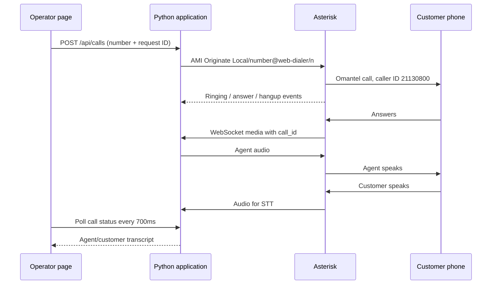

# Web call desk

Enter a phone number, press **Call customer**, follow the live transcript, and
use **End call** when needed. Asterisk rings the customer through Omantel and
connects the existing agent after answer. The page needs no microphone access.

The old `frontend/voice`, vendored browser SDK, WebRTC signaling/session code,
ICE/TURN helpers, aiortc/PyAV dependencies and Node frontend build are removed.
The separate text-only survey lab remains available.

The incoming pilot `21130800` and Linphone `6000`/`2000` retain their existing
routes. The new outbound route uses the primary Omantel SBC, `21130800` caller ID,
A-law/20ms and the existing `pipecat` WebSocket client. Failover remains disabled.

## How it connects



AMI binds only `127.0.0.1:5038`. Both containers use Ubuntu host networking.
The application receives no Docker socket or shell access. Operator input selects
only a validated number, not an endpoint, context, caller ID or dial string.

## Deploy on the existing Ubuntu server

Run from the pulled application checkout; replace the application path if needed.
First make an encrypted off-server backup using the
[server recovery guide](VOICE_SERVER_RECOVERY.md). Preserve your private `.env`.
No deployment command below places a call or changes network/firewall settings.

```bash
cd /home/data_mining/pipecat-example
sudo python3 -m scripts.prepare_web_dialer \
  --pbx-dir /home/data_mining/voice-pbx \
  --output /root/web-dialer-stage
```

The output directory must be new. This generates private random AMI/operator
passwords and stages the following files without installing or restarting:

- `extensions-before-web.conf`: original dialplan for rollback.
- `extensions.conf`: original dialplan plus `web-dialer` and `from-web-agent`.
- `manager.conf`: loopback AMI account, `read=call`, `write=originate,call`.
- `compose.web.yml`: additional read-only mount for `config/manager.conf`.
- `web-dialer.env`: private credentials and application settings.

The command refuses existing host `config/manager.conf` or duplicate web contexts;
review and merge those manually if already present. Review the dialplan diff:

```bash
sudo diff -u /home/data_mining/voice-pbx/config/extensions.conf \
  /root/web-dialer-stage/extensions.conf
sudoedit /root/web-dialer-stage/web-dialer.env
```

Set `OUTBOUND_ALLOWED_NUMBERS` to your own approved eight-digit test destination
for the first call. Blank permits any validated eight-digit Oman destination
except our own `211308XX` block. Prefixes `+968` and `00968` are normalized.
Keep credentials private; do not paste or commit them.

Confirm calls are idle before applying:

```bash
curl --fail --max-time 5 http://127.0.0.1:7861/health
docker exec voice-pbx-asterisk-1 asterisk -rx 'core show channels'
```

Proceed only when health reports `calls:0` and Asterisk reports zero active
channels. The new mount requires recreating Asterisk and interrupts active calls.
Write extensions **in place**, preserving the existing file mount:

```bash
sudo sh -c 'cat /root/web-dialer-stage/extensions.conf > /home/data_mining/voice-pbx/config/extensions.conf'
sudo cp /root/web-dialer-stage/compose.web.yml /home/data_mining/voice-pbx/compose.web.yml
PBX_GROUP=$(docker exec voice-pbx-asterisk-1 id -g)
case "$PBX_GROUP" in ''|*[!0-9]*) echo 'Cannot determine PBX group'; exit 1;; esac
sudo install -o root -g "$PBX_GROUP" -m 640 /root/web-dialer-stage/manager.conf \
  /home/data_mining/voice-pbx/config/manager.conf
```

Merge the private settings into the app's `.env`. This preserves provider/agent
settings, replaces the fragment's keys, creates a private rollback copy, and
prints no credentials:

```bash
cd /home/data_mining/pipecat-example
sudo python3 - "$PWD/.env" /root/web-dialer-stage/web-dialer.env <<'PY'
import os
from pathlib import Path
import re
import sys
os.umask(0o077)
target, fragment = map(Path, sys.argv[1:])
original = target.read_text(encoding="utf-8-sig")
addition = fragment.read_text(encoding="utf-8")
keys = {line.split("=", 1)[0] for line in addition.splitlines()
        if line and not line.startswith("#") and "=" in line}
with target.with_name(".env.before-web-dialer").open("x", encoding="utf-8") as saved:
    saved.write(original)
lines = [line for line in original.splitlines()
         if not ((match := re.match(r"^\s*(?:export\s+)?([A-Za-z_][A-Za-z0-9_]*)\s*=", line))
                 and match.group(1) in keys)]
target.write_text("\n".join(lines).rstrip() + "\n" + addition, encoding="utf-8")
PY
```

Build the new agent image, then recreate the PBX with the extra mount and start
the updated agent. Retain/tag the previous agent image if you need image rollback.

```bash
cd /home/data_mining/pipecat-example
docker compose -f docker-compose.ubuntu.yml build agent

cd /home/data_mining/voice-pbx
docker compose -f compose.yml -f compose.web.yml config --quiet
docker compose -f compose.yml -f compose.web.yml up -d --no-build --force-recreate asterisk
docker exec voice-pbx-asterisk-1 asterisk -rx 'manager show settings'
docker exec voice-pbx-asterisk-1 asterisk -rx 'dialplan show web-dialer'
docker exec voice-pbx-asterisk-1 asterisk -rx 'pjsip show contacts'

cd /home/data_mining/pipecat-example
docker compose -f docker-compose.ubuntu.yml up -d --no-build --force-recreate agent
curl --fail --max-time 5 http://127.0.0.1:7861/health
```

Always include `-f compose.web.yml` in future PBX recreation commands. Otherwise
the AMI config mount is omitted. Confirm AMI binds loopback only, the dialplan
loads and the carrier contact remains available. Asterisk 22.11.0 supports the
JSON WebSocket control protocol and URI parameters used for call correlation.

## Open and use the page

The application remains on server loopback port 7860. From your workstation:

```bash
ssh -N -L 7860:127.0.0.1:7860 data_mining@192.168.1.95
```

Open **http://127.0.0.1:7860**, log in as `operator` with the generated
`DIALER_PASSWORD` from the private staged environment file. Read/copy it locally
using `sudoedit`. For public access, use your HTTPS proxy. HTTP Basic login
protects the entire page and API. If the proxy also uses Basic authentication,
use matching credentials or remove its duplicate challenge so Authorization can
reach the app. Do not expose AMI or port 7861. No browser microphone is needed.

The active settings are in the application's `.env`; the staging fragment was
copied there during installation and is not read at runtime. `DIALER_PASSWORD`
requires at least 8 characters. After editing the active `.env`, recreate the
agent container to load the changed environment. Changing the password minimum
in application code also requires rebuilding its image. The AMI secret has a
separate minimum of 16 characters and must match Asterisk's `config/manager.conf`.

1. Confirm **Ready to call** and the intended `TELEPHONY_AGENT_ID`, `AGENT_ID`
   or existing questionnaire configuration.
2. Enter the approved test destination and press **Call customer**. This places
   a real Omantel call; deployment/tests never do so automatically.
3. Verify ringing, caller ID `21130800`, answer and bidirectional speech.
4. Follow agent/customer messages with timestamps and natural Arabic direction.
5. Test **End call** while ringing and while connected. Confirm channels and
   `/health` return to zero. Verify customer hangup, busy and no-answer.
6. Refresh during a call and download the transcript. Recheck incoming pilot and
   Linphone routes, carrier SDP/RTP and outbound service authorization.

The page/API prevent duplicate submissions; retried request IDs return the same
call. No automatic redial or failover occurs. An uncertain acknowledgement is
never retried as a new originate. Keep input unchanged when retrying a timed-out
request. Inbound telephone media counts toward the shared call cap.

Closing the tab leaves the call running until customer/agent hangup, **End call**
from a reopened page, or timeout. Default limits: two calls, 900 seconds each.
AMI loss stops agent media and reconciles known channels on reconnect; PBX
absolute timeouts also bound calls if the app disappears. The page's connection
status does not guarantee every speech provider succeeded; check sanitized logs
if audio fails. One application worker owns all call state.

Agent messages are synthesized output text, not private prompts/model reasoning.
Interruption can cut audible speech short while its full sentence remains in the
transcript. Customer messages are final STT results, including pickup greetings;
they appear after recognition rather than word by word. Polling runs every
700ms during calls. Transcript/audio contents are never logged.

Transcripts are bounded and held only in memory, expire an hour after call end,
and disappear on restart. Download a UTF-8 text copy if needed. The one operator
account can view this application's calls; this is not a multitenant call center.

## Recovery and rollback

Take a new encrypted off-server backup after deployment. The backup command
captures the entire PBX directory, including `config/manager.conf`, updated
extensions and `compose.web.yml`, plus the private application `.env` and exact
images. Restore all of those and use **both PBX Compose files**. This supersedes
the original five-mount startup command in the older recovery examples.

If PBX config files are lost but private credentials remain:

```bash
python3 -m scripts.prepare_pbx_recovery \
  --output /home/data_mining/voice-pbx \
  --lan-ip 192.168.1.95 \
  --password-file /private/linphone-password \
  --ami-secret-file /private/asterisk-ami-secret
```

The generator creates the six config files, local/inbound/web dialplan and Compose
override. Restore the matching `ASTERISK_AMI_SECRET`, `DIALER_PASSWORD` and
agent/provider settings in `.env`. If AMI credentials are lost, generate a new
secret and update both sides. Use the full recovery guide for images, numeric
UID/GID permissions, network/firewall and startup order. Saved images are preferred
to rebuilding the reference Dockerfile.

To disable new calls, set `OUTBOUND_ENABLED=false` and recreate only the agent
when idle. For full rollback, use the saved previous agent image and private
`.env.before-web-dialer`, restore `extensions-before-web.conf` **in place**, and
recreate the PBX with only the original Compose file. Preserve private backups.

## Verification and primary references

Offline checks use simulated AMI over a real local TCP socket, HTTP and private
media ownership tests. The Playwright fixture simulates calls without Azure,
Asterisk or Omantel. Image builds and real carrier calls require Ubuntu testing.

Local validation on 2026-11-04: Python discovery ran 169 tests (168 passed; the
Linux signal check was skipped on Windows). Both dialer and text-lab browser
checks passed. The dialer check covers mobile layout, live Arabic text, safe
rendering, refresh recovery, download, cancellation and repeated calls. The full
telephone pipeline check verifies synthesized agent/customer transcript frames
alongside media pacing, interruption and cleanup. No real calls were placed.

- [Asterisk 22 AMI Originate](https://docs.asterisk.org/Asterisk_22_Documentation/API_Documentation/AMI_Actions/Originate/) documents channel IDs, variables and asynchronous origination.
- [Asterisk WebSocket channel](https://docs.asterisk.org/Configuration/Channel-Drivers/WebSocket/) documents JSON media and `v()` URI parameters.
- [Asterisk 22 Dial](https://docs.asterisk.org/Asterisk_22_Documentation/API_Documentation/Dialplan_Applications/Dial/) documents `iI` forwarding/connected-line controls.
